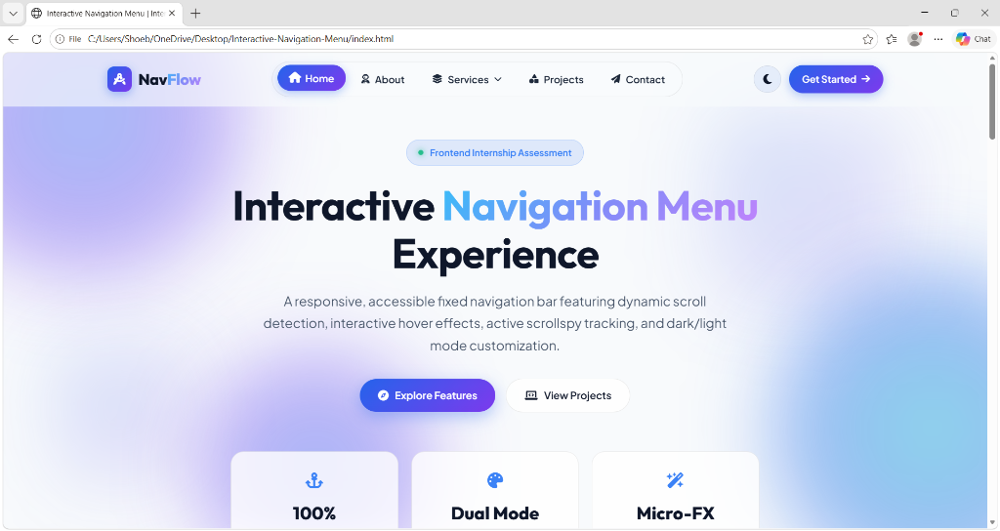
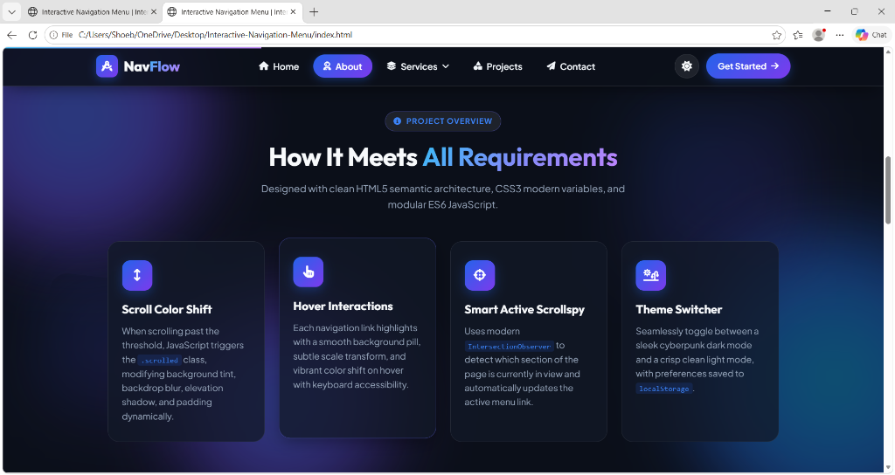
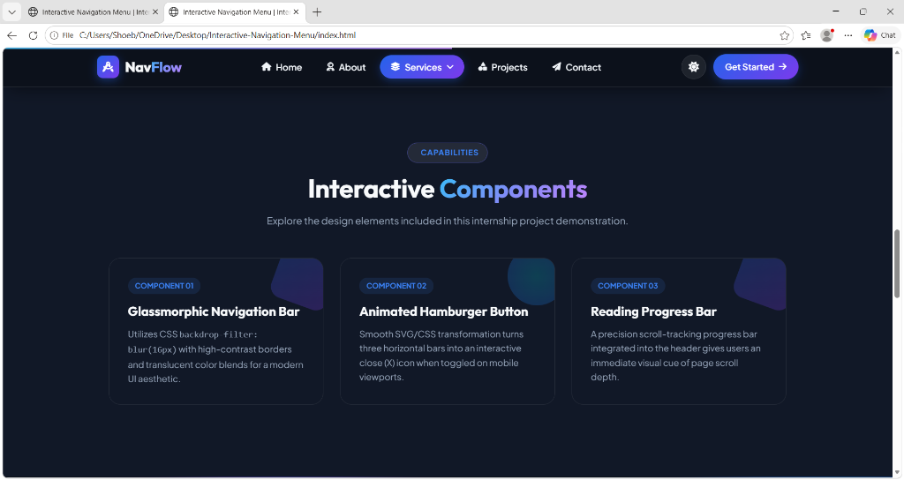
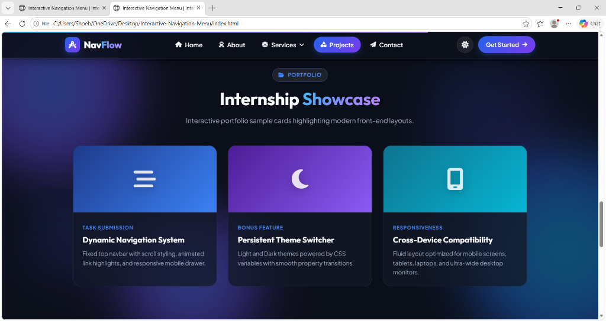
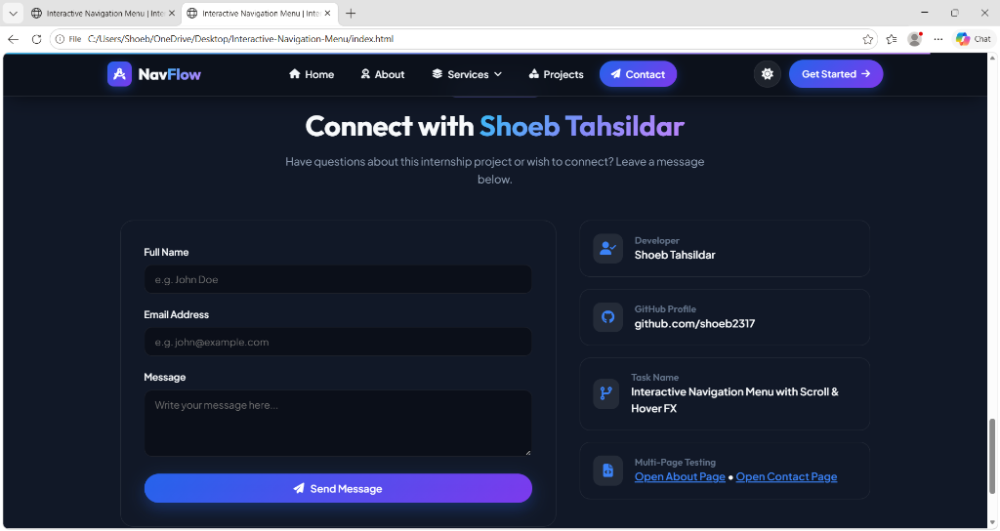

# 🌐 PRODIGY_WD_01: Interactive Navigation Menu

[](https://prodigyinfotech.dev/)
[](https://github.com/shoeb2317/PRODIGY_WD_01)
[](https://developer.mozilla.org/en-US/docs/Web/HTML)
[](https://developer.mozilla.org/en-US/docs/Web/CSS)
[](https://developer.mozilla.org/en-US/docs/Web/JavaScript)

> **Task 01 Submission for Prodigy InfoTech Internship**  
> **Developer:** Shoeb Tahsildar ([@shoeb2317](https://github.com/shoeb2317))  
> **Task Objective:** Build a responsive, interactive fixed navigation bar that dynamically alters its visual state, elevation, and style when the user scrolls, paired with interactive hover micro-animations and seamless section scrollspy tracking.

---

## 📸 Project Screenshots & Visual Showcase

### 1. Light Mode — Hero & Fixed Navigation Experience


### 2. Dark Mode — Dynamic Scroll Detection & Requirement Breakdown


### 3. Interactive Components & Reading Progress Indicator


### 4. Internship Showcase — Portfolio & Feature Highlights


### 5. Developer Profile & Contact Section


---

## 🚀 Key Features Implemented

1. **Fixed Navigation Bar (`position: fixed`)**
   - Stays permanently pinned to the top of the viewport during scrolling.
   - Preserves uniform branding, responsive styling, and navigation links across all pages (`index.html`, `about.html`, `contact.html`).

2. **Dynamic Scroll-Driven Transformation**
   - **Default Top State:** Translucent frosted glass effect (`backdrop-filter: blur(16px)`).
   - **Scrolled State (`.navbar.scrolled`):** Seamless transition into a darkened elevated header with compact height (`68px`), border glow, and subtle drop shadow.
   - **Reading Depth Progress Bar:** Built-in dynamic progress bar tracking scroll percentage across the document in real time.

3. **Rich Hover Interactions & Dropdown Menu**
   - Smooth pill-shaped background expansion on hover with subtle vertical translation (`translateY(-2px)`).
   - Multi-level dropdown submenus with fluid slide-down transitions and backdrop blur.
   - Custom animated SVG/CSS hamburger button transforming into an interactive "X" icon on mobile devices.

4. **Intelligent Section Scrollspy (`IntersectionObserver`)**
   - Automatically detects the currently active viewport section and highlights the corresponding navigation item smoothly without manual calculation overhead.

5. **Theme Switcher (Dark & Light Mode)**
   - Toggle button enabling instant switching between a cyber dark mode and clean light theme.
   - Remembers user preferences persistently across page reloads using browser `localStorage`.

6. **Fully Responsive Across All Screen Sizes**
   - Fluid typography, CSS Grid, and Flexbox layouts optimized for mobile phones, tablets, laptops, and ultra-wide displays.

---

## 📁 Repository Structure

```
PRODIGY_WD_01/
├── index.html                           # Main landing page with full interactive demo
├── about.html                           # Multi-page test page (About)
├── contact.html                         # Multi-page test page (Contact)
├── style.css                            # Modern styling, CSS variables, glassmorphism, animations
├── script.js                            # Vanilla JS: scroll detection, scrollspy, dropdown, themes
├── showcase.html                        # Visual infographic showcase for LinkedIn / portfolio
├── task-auth-showcase.html              # Extended assessment showcase layout
├── POST_CAPTION.md                      # Pre-formatted caption for LinkedIn & social submissions
├── Prodigy Task1.jpg                    # Task certification / banner asset
├── screenshots/                         # High-resolution application screenshots
│   ├── 01-light-mode-hero.png
│   ├── 02-dark-mode-scrollspy-about.png
│   ├── 03-interactive-components-services.png
│   ├── 04-internship-showcase-projects.png
│   └── 05-contact-developer-section.png
└── README.md                            # Comprehensive project documentation
```

---

## 🛠️ How to Run Locally

1. **Clone the repository:**
   ```bash
   git clone https://github.com/shoeb2317/PRODIGY_WD_01.git
   cd PRODIGY_WD_01
   ```

2. **Open the project:**
   - Double-click `index.html` to open directly in any modern browser (Chrome, Edge, Firefox, Brave, Safari).
   - Or serve with VS Code Live Server or any static file server:
     ```bash
     npx serve .
     ```

3. **Verify features:**
   - **Scroll down:** Watch the navbar background tint, elevation shadow, and top progress bar respond to scroll position.
   - **Hover over links:** Notice the animated glowing pill background highlights.
   - **Toggle theme:** Click the Moon/Sun icon on the top right to toggle Dark/Light mode.
   - **Mobile view:** Resize your browser to test the animated hamburger menu drawer.

---

## 💻 Tech Stack

- **HTML5:** Semantic tags (`<header>`, `<nav>`, `<main>`, `<section>`, `<article>`, `<footer>`).
- **CSS3:** Custom Properties (Variables), Flexbox, CSS Grid, Glassmorphism (`backdrop-filter`), CSS transitions & keyframe animations.
- **JavaScript (ES6):** `IntersectionObserver` API, event throttling, DOM manipulation, `localStorage` persistence.

---

## 👤 Author

- **Shoeb Tahsildar**
- **GitHub:** [@shoeb2317](https://github.com/shoeb2317)
- **Internship:** Prodigy InfoTech — Web Development Track (Task 01)
